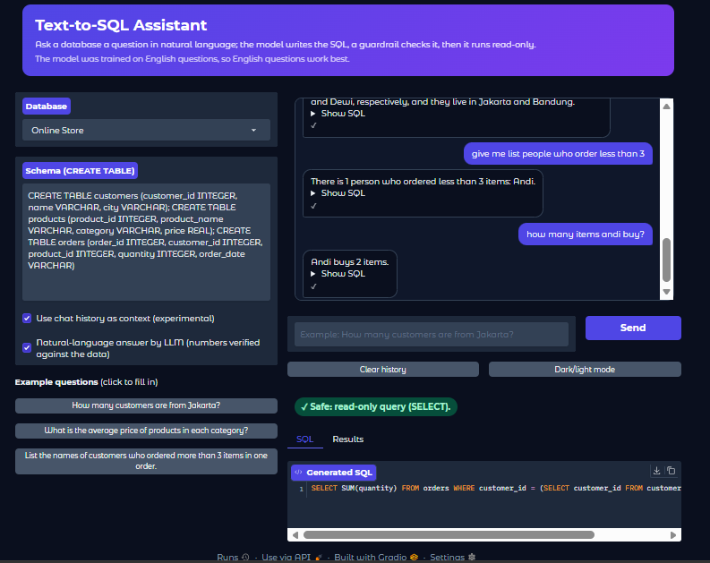
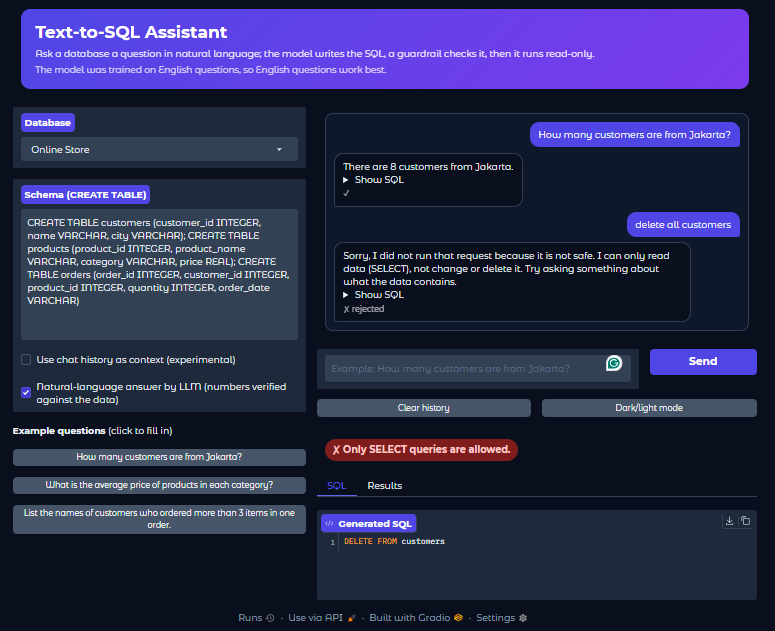
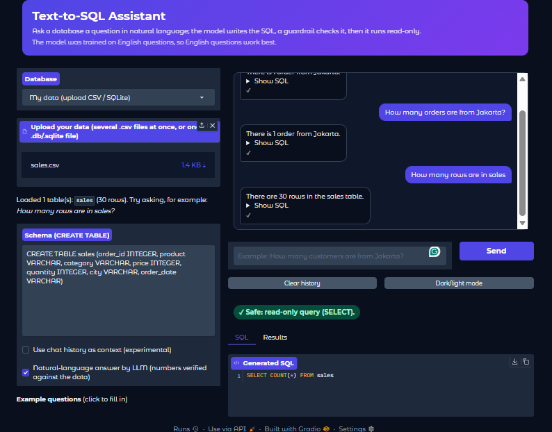
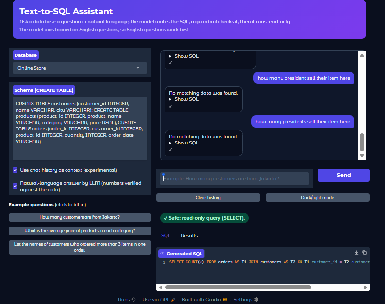

# Text-to-SQL Assistant (QLoRA + Gradio)

Fine-tuning `Qwen2.5-Coder-3B-Instruct` (4-bit, QLoRA, Unsloth) to turn a natural-language question plus a table schema into
SQLite SQL, with measured evaluation, a SQL safety guardrail, and a Gradio question-answering interface.
Designed to run on **Google Colab** (T4 GPU; Kaggle also works) with economical settings.

Method and limitations: [`REPORT.md`](REPORT.md). Model card: [`MODEL_CARD.md`](MODEL_CARD.md).

## Pipeline

```
sql-create-context (HF) -> clean + split by schema -> baseline of the base model
        -> QLoRA (Unsloth) -> adapter on the HF Hub -> evaluation before vs after
        -> guardrail (validator + read-only) -> Gradio UI + example databases
```

## Results

<!-- RESULTS_START -->
**Evaluation results (filled automatically from `results/metrics.json`):**

| Metric | Baseline (before tuning) | Fine-tuned (QLoRA) |
|---|---|---|
| Number of test examples | 300 | 300 |
| Exact match (normalized) | 49.7% | 75.3% |
| Execution match (synthetic data) | 46.6% | 86.2% |
| Execution match (non-empty gold result) | 45.6% | 86.7% |
| Prediction execution error rate | 4.0% | 0.0% |

**By complexity category (execution match):**

| Category | Baseline (before tuning) (n) | Fine-tuned (QLoRA) (n) |
|---|---|---|
| simple | 44.2% (217) | 86.1% (217) |
| aggregation | 50.6% (79) | 87.0% (79) |
| join | 100.0% (4) | 75.0% (4) |
| nested | - | - |

Final loss: train = 0.030521079897880554, validation = 0.04360850900411606 (313 steps).

Model on Hugging Face: https://huggingface.co/dwicahyom16/qwen2.5-coder-3b-text2sql-qlora

<!-- RESULTS_END -->

## UI

Ask questions in natural language; the answer is a sentence written from the query result, and the SQL can be expanded:



The guardrail refuses commands that change or delete data:



Upload your own CSV files and ask about them:



When the data cannot answer a question, the app says so instead of crashing or inventing an answer:



## Structure

| Folder/File | Contents |
|---|---|
| `Fine-tuning_submission/` | `01_data_prep_and_baseline.ipynb`, `02_finetune_qlora.ipynb`, `data_prep.py`, `train_qlora.py` |
| `Evaluation_submission/` | `03_evaluation.ipynb`, `evaluate.py`, `results/` (real results) |
| `Interface_submission/` | `04_interface_demo.ipynb`, `app.py`, `assets/style.css`, `screenshots/` |
| `src/` | `prompt_utils`, `sql_utils`, `guardrail`, `eval_utils`, `demo_db`, `answer_utils` (robust answering), `upload_db` (CSV/SQLite upload) |
| `tests/` | tests for the guardrail, SQL utilities, and the UI logic (with a mock model) |
| `REPORT.md`, `MODEL_CARD.md`, `link_huggingface.txt`, `requirements.txt` | documentation and metadata |

## How the assistant answers (robustness for free-form questions)

1. **Language:** a question in Indonesian is translated to English first (the SQL model was trained on English). The answer is written in the language of the question.
2. **Self-correction:** if the generated SQL is invalid or fails, it is sent back to the model together with the error, up to 3 attempts in total.
3. **Case-insensitive retry:** if a query returns nothing, it is retried once with case-insensitive text comparison (`'Jakarta'` vs `'jakarta'`).
4. **LLM-written answers:** the query result is sent to the LLM (the SQL adapter is switched off temporarily so the base Qwen2.5-Coder acts as a chat model),
   which writes the answer in varied wording. Every number in the answer is **verified** against the result; an answer with an untraceable number is rejected and regenerated.
5. **No raw errors:** if nothing works, the LLM explains politely that it could not answer from the data; a plain sentence is only the last resort when no LLM is available.
6. **Safety is final:** anything that is not a read-only `SELECT` is refused with a fixed message and is never retried or "fixed" into something runnable.

The model is still a small 3B model: it can write a wrong or inefficient query, and no software can guarantee a correct answer to every possible question.

## Using your own data (UI)

In the UI choose **My data (upload CSV / SQLite)**, then upload several `.csv` files at once or one `.db`/`.sqlite` file. The schema is built automatically from the files,
queries run read-only on your data, and answers are written as sentences. Limits: 25 MB per file, at most 6 tables and 25 columns per table
(small model context). Do not upload confidential data if you use a public share link.

## Running on Google Colab

1. **Accounts:** Google (Colab) and Hugging Face (create a token with *Write* permission under Settings -> Access Tokens).
2. **Open a notebook:** upload the `.ipynb` from the project folder to <https://colab.research.google.com> (File -> Upload notebook).
   To avoid uploading the zip every time: put `Text2SQL_Dwi-Cahyo-Mariyanto.zip` once in *My Drive*; the first cell finds it by itself
   (allow Drive access). If it is not on Drive, the cell asks you to upload it from your computer.
3. **GPU:** *Runtime -> Change runtime type -> T4 GPU*. Run the first cell; when asked, choose this project's zip (the cell places it in `/content`).
   Optional: set `USE_DRIVE = True` in the first cell so results are kept on Google Drive if the session drops.
4. **Token entered manually:** the token cell shows a hidden input box; paste your HF token and press Enter. The token is not saved in any file
   (alternative: a Colab Secret named `HF_TOKEN` with *Notebook access* on). `hf_username` is filled in automatically from the token.
5. **Run in order:** `01` (baseline) -> `02` (training, roughly 1 hour; rough estimate) -> `03` (evaluation) -> `04` (UI).
   Each notebook uses a separate Colab session, so `02` pushes the adapter to Hugging Face and `03`/`04` fetch it automatically from that repo
   (its contents are checked before use). The test data is rebuilt with the same seed, so the split is identical.
6. **Save results:** the last cell of each notebook downloads a results zip. Copy its contents to `Evaluation_submission/results/`, and the UI screenshots to
   `Interface_submission/screenshots/`. Also download the notebooks with their outputs: File -> Download -> `.ipynb`.
7. **Fill the documents from the real results:** `python Evaluation_submission/evaluate.py --fill-docs`
   (fills the results block in `REPORT.md`, `README.md`, `MODEL_CARD.md`).
8. **Publish:** write the model link in `link_huggingface.txt`; copy `MODEL_CARD.md` as `README.md` in the model repo on Hugging Face.
9. **Library versions:** replace `requirements.txt` with `results/environment.txt` (recorded automatically by notebook 02).

## Running the UI

```bash
pip install gradio unsloth
python Interface_submission/app.py --model <hf-username>/qwen2.5-coder-3b-text2sql-qlora --share
python Interface_submission/app.py --mock      # test the layout without a GPU (mock model, not real model output)
```

## Running the tests (CPU only)

```bash
pip install pytest
python -m pytest tests -q
```

## Short list of limitations
Trained on English questions; execution match uses synthetic data; small subset (5,000 examples, 1 epoch) without ablation.
Details in `REPORT.md`.

## Attribution
Dataset `b-mc2/sql-create-context` (CC-BY-4.0; built from WikiSQL and Spider). Base model Qwen2.5-Coder through Unsloth.
Check the base model license before commercial use.
